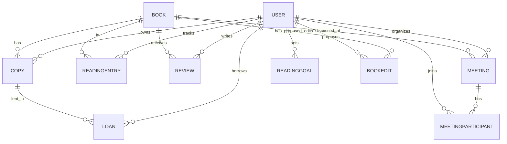

# BookCircle — книжный клуб и обмен книгами

Django + DRF (бэкенд, `core/`) и SPA на Bootstrap + Tailwind (`frontend/index.html`).

## Запуск на чистой базе
```bash
python -m venv venv
venv/bin/activate      
pip install -r requirements.txt
python manage.py migrate
python manage.py seed            
python manage.py runserver      
python manage.py test            
```
Фронтенд отдаётся самим Django на главной странице, отдельный сервер не нужен. Если адрес API другой — поменяйте `API` в начале скрипта `frontend/index.html`.

## Аккаунты для преподавателя
| Роль | Логин / пароль |
|---|---|
| Администратор (+ `/admin/`, назначение ролей) | admin / admin12345 |
| Модератор | moder / moder12345 |
| Участники | aida, bakyt, nurlan, aigerim, timur / pass12345 |

## ER-диаграмма

Обоснование отличий от модели в ТЗ: у `User` добавлены `role`, `bio`; у `Book` — служебное `search_text`
(регистронезависимый поиск по кириллице в SQLite); у `Review` — `created_at/updated_at`.

## Что реализовано в БД
- Индексы: FK, `Book.title/author/genre`, `Loan.status`, `(borrower,status)`, `(owner,is_active)`, `Review.is_hidden`, `finished_at`.
- `UNIQUE(copy) WHERE status IN (accepted, handed_over)` — не более одной принятой/активной передачи на экземпляр.
- `UNIQUE(user,book)` для записи чтения и рецензии; `CHECK(score BETWEEN 1 AND 5)`; `UNIQUE(title,author)`.
- `PROTECT` у Loan/Copy: история обменов не удаляется каскадно. `CASCADE` только для личных записей пользователя (чтение, отзывы).

## Бизнес-правила на сервере
Переходы: ожидает → принята/отклонена/отменена; принята → передана/отменена; передана → возвращена (иначе 409).
Принятие блокирует экземпляр (`select_for_update`) и автоматически отклоняет остальные запросы.
Передаваемый экземпляр нельзя скрыть/удалить; себе книгу не запросить; просрочка — поле `is_overdue`;
рейтинг без скрытых отзывов; «прочитано за месяц» — по `finished_at`. Роль назначает только администратор.
Коды: 400 ввод, 401/403 доступ, 404 нет объекта, 409 конфликт состояния.

## Критерии приёмки → где проверить
| Критерий | Проверка |
|---|---|
| Два экземпляра у разных владельцев независимы | тест `test_two_copies_book_independently` |
| Принять → передать → вернуть | `test_full_cycle_restores_availability` |
| Нельзя принять двух заёмщиков | `test_cannot_accept_two_borrowers` |
| Правка отзыва меняет рейтинг без дубля | `test_review_edit_changes_rating_without_duplicate` |
| Права, ошибки, статусы | `test_permissions_validation_and_transitions` |
| Запуск по README | раздел «Запуск» |

## API
`POST auth/register|login|logout`, `GET/PATCH auth/me` · `GET/POST books/`, `GET/PATCH books/{id}/`, `PUT books/{id}/review/` ·
`GET/POST copies/`, `PATCH/DELETE copies/{id}/`, `POST copies/{id}/loans/` · `GET loans/?box=incoming|outgoing`,
`POST loans/{id}/accept|reject|cancel|hand-over|return/` · `GET reading/`, `PUT reading/{book_id}/` ·
`GET reviews/`, `PATCH reviews/{id}/` (модератор).

## Запуск в Docker
```bash
docker compose up --build
```
Поднимаются PostgreSQL 16 и Django (gunicorn). При старте автоматически применяются миграции и (по умолчанию) загружаются демоданные.
- Сайт: http://localhost:8000/ · админка: http://localhost:8000/admin/
- Код сброса пароля печатается в логах: `docker compose logs -f web`
- Настройки через файл `.env` (образец — `.env.example`): `SECRET_KEY`, `POSTGRES_PASSWORD`, `GOOGLE_CLIENT_ID`, `SEED_DEMO=0` (не загружать демоданные), `ALLOWED_HOSTS`, `CSRF_TRUSTED_ORIGINS`, `FRONTEND_URL` (если сайт не на localhost).
- Остановить: `docker compose down` (база сохраняется в томе `pgdata`); удалить и базу: `docker compose down -v`.
- Тесты в контейнере: `docker compose run --rm web python manage.py test`
- Пересоздать демоданные: `docker compose exec web python manage.py seed --reset`

Перед реальным использованием смените `SECRET_KEY`, пароль БД и пароли демо-аккаунтов (`SEED_DEMO=0`).

## Дополнительные функции (после обязательного минимума)
- **Книжные встречи.** Любой участник назначает встречу (название, книга, дата и время, место, число мест). Записаться/выйти, организатор или модератор отменяет.
  Правила: нельзя записаться на отменённую, прошедшую или заполненную встречу (проверка атомарна, `select_for_update`), организатор не выходит из своей встречи,
  нельзя уменьшить число мест ниже числа участников. Страница «Встречи» (вкладки «Предстоящие / Мои / Прошедшие»), на странице книги — её ближайшие встречи.
- **Цели чтения.** Цель на год и/или на месяц (1–365 книг). Прогресс считается по книгам со статусом «Прочитал» и датой завершения в этом периоде. Страница «Моё чтение».
- **Рекомендации по жанрам.** По жанрам вашего чтения (прочитал — вес 2, читаю/хочу — 1) и оценок (4–5 — плюс, 1–2 — минус) подбираются книги, которых ещё нет в вашем списке и без отзыва;
  при равенстве выше те, что лучше оценены и доступны. Если данных ещё нет — показывается «популярное в клубе». Блок «Рекомендуем вам» на главной странице каталога.
- **Жанры.** Добавлены «Ужасы» (демо: Лавкрафт, Стивен Кинг) и «Учебники и пособия по IT». Список жанров приходит с сервера (`GET /api/genres/`),
  модератор может завести и новый жанр. Демоданные по-прежнему содержат 15 произведений (часть прежних заменена книгами новых жанров).
- **Редактирование своего отзыва.** На странице книги ваш отзыв помечен «Ваш отзыв» с кнопкой «Изменить», форма ниже подставляет текущую оценку и текст;
  рейтинг пересчитывается, дубликатов нет. Если модератор скрыл отзыв, правка возможна, но он остаётся скрытым.

## Модерация, роли и новые правила
| Действие | Участник | Модератор | Администратор |
|---|---|---|---|
| Предложить книгу | да, после модерации | сразу публикуется | сразу публикуется |
| Предложить правку книги | да, после модерации | правит сразу | правит сразу |
| Одобрить / отклонить (с причиной) книги и правки | нет | да | да |
| Скрыть книгу или рецензию | нет | да | да |
| Удалить рецензию | только свою | нет | любую |
| Удалить книгу | только свою неодобренную | нет | любую |

- **Книги от участников.** Статусы: «На модерации» → «Опубликована» / «Отклонена» (причина видна автору) и «Скрыта». Пока книга не одобрена, она видна только автору и модераторам и не попадает в каталог,
  списки выбора, рекомендации и встречи. Отклонённую книгу автор может исправить — она снова уходит на модерацию. Страница «Предложить книгу» показывает все ваши предложения и правки.
- **Правки.** У участника не более одной ожидающей правки на книгу; модератор видит «было → стало» и применяет или отклоняет её.
- **Удаление книги администратором** — только если нет принятых или переданных экземпляров. Вместе с книгой явно удаляются её экземпляры, отзывы, отметки чтения и история обменов (в окне подтверждения об этом сказано),
  встречи остаются без привязки к книге. Скрытие — безопасная альтернатива удалению.
- **Подтверждения.** Выход из аккаунта, удаление (отзывов, книг, целей, предложений), отмена и отклонение обменов, отмена встречи — через окно подтверждения в стиле сайта. При отклонении книги или правки окно запрашивает причину.
- **Оценки.** Шаг 0,5 (от 1 до 5, например 3,5). Звёзды выбираются кликом по левой или правой половине звезды; в рейтинге и на карточках отображаются половинки звёзд.
- **Телефон.** Получатель указывает телефон при запросе книги (подставляется из профиля, обязателен, проверяется формат). Владелец видит его в «Обменах». Телефон владельца (из профиля) открывается получателю после принятия запроса.
- **Аренда и просрочка.** Вкладка «На руках» в «Обмены» показывает срок возврата и сколько осталось/просрочено. Если срок истёк или истекает в ближайшие 2 дня, на каждой странице показывается предупреждение
  и получателю (верните книгу), и владельцу (книгу задерживают), с телефоном второй стороны; в меню у «Обмены» появляется значок.
- **«Моя полка».** Список выбора содержит все одобренные книги каталога (без ограничения по числу) и поиск по названию/автору.
- **Тёмная тема.** Кнопка ☾/☀ в шапке; выбор запоминается, по умолчанию берётся тема системы.

**Обновление с прошлой версии:** `python manage.py migrate` (существующие книги становятся «одобренными», оценки сохраняются, у старых передач телефон пустой).
Демоданные (`seed --reset`) теперь содержат ещё одну книгу и одну правку на модерации и оценки с половинками.

## Сброс пароля (без Gmail/SMTP)
1. На странице входа: «Забыли пароль?» → вводите email.
2. Сервер печатает письмо **в терминал, где запущен `runserver`** (`core.mail.TerminalEmailBackend`, настройка `EMAIL_BACKEND`
   в `config/settings.py`): 6-значный код и ссылка вида `http://127.0.0.1:8000/#/reset?email=…&code=123456`.
3. Введите код (или откройте ссылку — код подставится сам) и задайте новый пароль.

Код действует 10 минут, одноразовый, в базе хранится только его HMAC-хэш; после 5 неверных попыток код блокируется,
новый запрос отменяет предыдущий код. Ответ одинаков для существующих и несуществующих email, запросы ограничены по частоте (5/час).
После сброса все сессии пользователя завершаются. Для реальной рассылки замените `EMAIL_BACKEND` на SMTP-бэкенд вашего почтового сервиса.
Ссылка не зашифрована: безопасность держится на одноразовом коротком по времени коде, а не на секретности ссылки.

## Привязка к Google
1. [Google Cloud Console](https://console.cloud.google.com/) → APIs & Services → Credentials → Create credentials → **OAuth client ID** → Web application.
2. В **Authorized JavaScript origins** добавьте `http://localhost:8000` и `http://127.0.0.1:8000`. Скопируйте Client ID.
3. Запускайте сервер с переменной окружения:
   - Linux/macOS: `GOOGLE_CLIENT_ID=ваш_id python manage.py runserver`
   - Windows PowerShell: `$env:GOOGLE_CLIENT_ID="ваш_id"; python manage.py runserver`
4. На странице входа появится кнопка Google; в профиле — «Привязать / Отвязать Google».

Правила: сервер сам проверяет подпись и срок Google ID-токена, `audience` и `email_verified`. Вход через Google создаёт аккаунт без пароля;
если email уже занят обычным аккаунтом, автоматической привязки нет (защита от угона) — войдите по паролю и привяжите Google в профиле.
Отвязать Google можно, только если у аккаунта есть пароль (его можно задать через сброс пароля).
Адрес в браузере должен совпадать с одним из origin в консоли Google.

## Частые проблемы
- **Каталог пуст** — не выполнен `python manage.py seed` (после удаления `db.sqlite3` нужно снова `migrate` и `seed`; `seed --reset` пересоздаёт демоданные).
- **Код сброса пароля не пришёл** — смотрите терминал, где запущен `runserver` (не браузер и не почту). Email должен совпадать с email аккаунта
  (у `seed`-пользователей это `имя@example.com`, например `aida@example.com`). В режиме разработки (`DEBUG=True`) для неизвестного email сайт сообщит об этом явно.
- Убедитесь, что в `config/settings.py` есть `EMAIL_BACKEND = 'core.mail.TerminalEmailBackend'`, и перезапустите сервер после правок.
- **Google: после выбора аккаунта белое окно, в консоли `Cannot read properties of null (reading 'postMessage')`** — заголовок
  `Cross-Origin-Opener-Policy: same-origin` (по умолчанию в Django) блокирует связь окна Google с сайтом. В `settings.py` должно быть
  `SECURE_CROSS_ORIGIN_OPENER_POLICY = 'same-origin-allow-popups'`; после правки перезапустите сервер и обновите страницу (Ctrl+F5).
- **Google: «Аккаунт с этим email уже существует»** — сначала войдите по паролю, затем привяжите Google в профиле.
- **Docker не стартует / сайт не открывается** — смотрите `docker compose logs web`; порт 8000 должен быть свободен; при доступе не по `localhost` задайте `ALLOWED_HOSTS`.

## Дополнительные маршруты API
`GET /genres/` · `GET/POST /meetings/` (`?when=upcoming|mine|past`, `?book=id`), `GET/PATCH /meetings/{id}/`, `POST /meetings/{id}/join|leave|cancel/` ·
`GET/PUT /goals/` (`{period: year|month, target}`), `DELETE /goals/{year|month}/` · `GET /recommendations/` ·
`PUT /books/{id}/review/` — 201 при создании и 200 при правке отзыва.

## API: модерация, удаление, аренда
`GET/POST /books/` (любой участник; книга участника — `pending`), `GET/PATCH/DELETE /books/{id}/`, `GET /books/options/` (все одобренные книги для списков),
`POST /books/{id}/hide|unhide/`, `POST /books/{id}/edits/` · `GET /submissions/` · `GET /moderation/books|edits/`, `POST /moderation/books|edits/{id}/approve|reject/` (`{reason}`) ·
`DELETE /books/{id}/review/` (свой отзыв), `DELETE /reviews/{id}/` (администратор) · `POST /copies/{id}/loans/` (`requested_return_date`, `phone`) ·
`GET /loans/?box=incoming|outgoing|active` · `GET /alerts/` (просроченные и скоро истекающие аренды).
