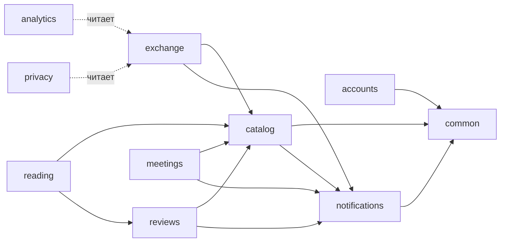
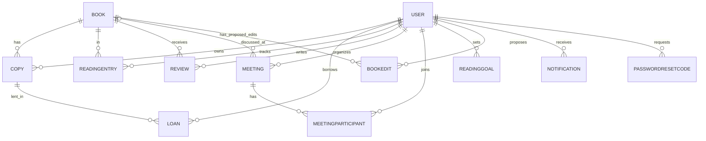

# Архитектура

BookCircle — модульный монолит на Django: одно развёртываемое приложение, разделённое на изолированные доменные приложения
с явной схемой зависимостей. Такой дизайн даёт простоту эксплуатации монолита и возможность выделить любое приложение
в отдельный сервис, когда это понадобится.

## Приложения

| Приложение | Ответственность | Модели | Зависит от |
|---|---|---|---|
| `common` | общее ядро: исключения, права, пагинация, кэш-хелпер, JSON-логи, middleware, `/healthz` и `/readyz`, почтовый бэкенд | — | — |
| `accounts` | регистрация, вход, профиль, сброс пароля по коду, вход через Google | `User`, `PasswordResetCode` | common |
| `notifications` | уведомления на сайте и по email (фоновая отправка) | `Notification` | common |
| `catalog` | книги, жанры, предложение книг и правок, модерация, скрытие, удаление | `Book`, `BookEdit` | common, notifications |
| `exchange` | экземпляры на полках, запросы и передачи, сроки и просрочка, напоминания | `Copy`, `Loan` | common, catalog, notifications |
| `reviews` | отзывы с оценкой 1–5 (шаг 0,5), модерация отзывов | `Review` | common, catalog, notifications |
| `reading` | статусы чтения, цели, рекомендации по жанрам | `ReadingEntry`, `ReadingGoal` | common, catalog, reviews |
| `meetings` | книжные встречи и запись на них | `Meeting`, `MeetingParticipant` | common, catalog, notifications |
| `analytics` | показатели платформы для модераторов, публичная статистика | — | читает все домены |
| `privacy` | выгрузка данных пользователя и удаление аккаунта | — | читает все домены |
| `demo` | демоданные (`seed`) и нагрузочные данные (`seed_bulk`) | — | читает все домены |
| `web` | витрина: страница SPA, юридические страницы, статика | — | — |

**Правило:** зависимости идут только «вниз» по схеме. Правило проверяет тест `common/test_architecture.py` — запрещённый
импорт ломает сборку. `analytics`, `privacy` и `demo` — листья графа: они собирают данные из многих приложений, но никто от них не зависит.

### Как каталог обходится без знания о соседях
Каталог должен знать о копиях, отзывах и чтении (рейтинг, «свободно экземпляров»), а удалять книгу — вместе с ними, но не должен их импортировать:

- **Агрегаты** (`catalog/selectors.py`) считаются подзапросами к моделям, взятым из реестра `apps.get_model(...)`. Импорта нет, а запрос быстрый (см. [SCALING.md](SCALING.md)).
- **Удаление книги** — сигнал `catalog.signals.book_deleting`. Подписчики: `exchange` (запрещает удаление при активной передаче, иначе стирает передачи и экземпляры),
  `reviews`, `reading` (стирают свои записи), `meetings` (отвязывает встречи). Исключение подписчика откатывает удаление целиком.
- **Страница книги** собирается на клиенте из ответов владельцев данных: `/books/{id}/` (каталог), `/copies/` (обмены), `/reviews/` (рецензии),
  `/reading/{id}/` (чтение), `/meetings/?book=` (встречи). Каждый эндпоинт кэшируется и масштабируется независимо.

## Роли и права

| Действие | Гость | Участник | Модератор | Администратор |
|---|---|---|---|---|
| Смотреть каталог, отзывы, экземпляры | да | да | да | да |
| Запросить книгу, вести полку, встречи, цели | — | да | да | да |
| Предложить книгу / правку | — | на модерацию | публикует сразу | публикует сразу |
| Одобрить/отклонить, скрыть книгу или отзыв | — | — | да | да |
| Удалить отзыв / книгу | — | свой отзыв, свою неодобренную книгу | — | любые |
| Показатели платформы | публичные цифры | — | да | да |

Роли назначаются только в админке (`/admin/`); через API роль изменить нельзя. Права проверяются на сервере (`common/permissions.py`).

## Модель данных

Гарантии на уровне БД: не более одной принятой/активной передачи на экземпляр (частичный уникальный индекс), одна рецензия и одна запись чтения на пару пользователь/книга,
оценка 1–5, положительная вместимость встречи, уникальность живых книг по (название, автор). Исторические записи не удаляются каскадом (`PROTECT`):
при удалении книги/аккаунта история обменов стирается или обезличивается явным кодом, а не побочным эффектом.

## Потоки

- **Запрос → передача → возврат.** `LoanCreate` блокирует экземпляр (`select_for_update`), проверяет правила; `LoanAction` проводит переход по таблице `RULES`,
  принятие отклоняет остальные запросы. После успешного перехода сервис `exchange.services` создаёт уведомления; письма уходят в Celery после фиксации транзакции.
- **Просрочка.** Статус «передана» + дата возврата в прошлом = просрочка (вычисляется, не хранится). `/alerts/` отдаёт просроченные и скоро истекающие аренды обеим сторонам;
  ежедневная задача `exchange.tasks.remind_overdue` создаёт напоминания (не чаще раза в день на передачу).
- **Модерация.** Книга участника создаётся со статусом `pending` и невидима вне автора и модераторов; одобрение/отклонение уведомляет автора.
- **Кэш.** `common.cache`: версионированные ключи; изменение книги увеличивает версию `catalog` и мгновенно сбрасывает списки жанров и выбора книг.

## Соглашения API

Префикс `/api/`, JSON, пагинация `{count, results}`, авторизация `Authorization: Token …`.
Коды: 400 — ошибки ввода (по полям), 401/403 — доступ, 404 — нет объекта (или он скрыт), 409 — конфликт состояния, 429 — лимит запросов, 503 — недоступна внешняя зависимость.
Документация генерируется из кода: `/api/docs/` (Swagger UI), `/api/redoc/`, `/api/schema/` (OpenAPI 3).

## Тесты

| Уровень | Что | Где |
|---|---|---|
| Модульные и API | сценарии каждого приложения, права, переходы, ограничения БД, уведомления, N+1-защита | `<app>/tests.py` |
| Сквозные | жизненный цикл книги между приложениями | `common/test_integration.py` |
| Архитектурные | схема зависимостей, здоровье, кэш, логи | `common/test_architecture.py`, `common/tests.py` |
| Интерфейс | страницы всех ролей и действия (звёзды, окна подтверждения, модерация, удаление аккаунта) в jsdom | `tests_ui/` |

## Как добавить приложение
1. `python manage.py startapp name`, добавить в `INSTALLED_APPS` (`config/settings/base.py`) и маршруты в `config/urls.py`.
2. Записать разрешённые зависимости в `ALLOWED` в `common/test_architecture.py` (тест напомнит, если забыть).
3. Связи с другими доменами — через строковые FK (`'catalog.Book'`), сигналы и `apps.get_model`, а не импорты.

## Известные ограничения
- Один общий сообщество-пространство: мультитенантность — следующий большой этап (дизайн в [SCALING.md](SCALING.md)).
- Обложки хранятся как URL, загрузка файлов не реализована.
- Поиск — подстрока по названию и автору (на PostgreSQL ускорен триграммным индексом), без ранжирования и морфологии.
- OpenAPI-схема: модели, списки и CRUD описаны полностью, а у части «действий» (запрос книги, переходы, цели и т. п.) тела запросов и ответов описаны обобщённо; подробности — в этом документе и в тестах.
- Токены входа бессрочные до выхода; нет двухфакторной аутентификации и подтверждения email.
